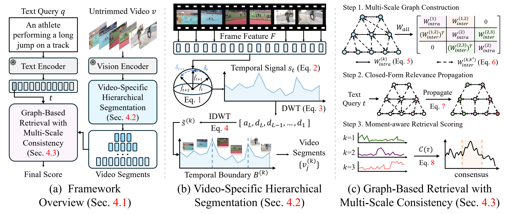

<p align="center">
  
</p>

<h1 align="center">TF-PRVR:<br>Training-Free Partially Relevant Video Retrieval</h1>

<p align="center">
  <a href="https://giyeolkim.github.io/">Giyeol Kim</a> &nbsp;&nbsp;&nbsp;
  <a href="https://sites.google.com/view/pai-lab/members_1/faculty?authuser=0">Chanho Eom</a><sup>&dagger;</sup>
</p>

<p align="center">
  <a href="https://sites.google.com/view/pai-lab/home?authuser=0"><b>Perceptual AI Lab</b></a><br>
  GSAIM, Chung-Ang University
</p>

<p align="center">
  <sup>&dagger;</sup>Corresponding author
</p>

<p align="center">
  <a href="https://perceptualai-lab.github.io/TF-PRVR/"></a>
  &nbsp;
  <a href="https://perceptualai-lab.github.io/TF-PRVR/#demo"></a>
  &nbsp;
  <a href="https://arxiv.org/pdf/2610.07925"></a>
  &nbsp;
  <a href="https://arxiv.org/abs/2610.07925"></a>
</p>

<p align="center">
  TF-PRVR retrieves untrimmed videos from natural-language queries using frozen vision-language features, adaptive temporal segments, and multi-scale relevance propagation&mdash;without task-specific training.
</p>

---

## Overview

Partially relevant video retrieval asks whether a video contains a moment matching a query. TF-PRVR adapts the temporal representation to each video and combines evidence from the same moment across scales.

<p align="center">
  <a href="assets/framework.png"></a>
</p>

1. **Video-specific hierarchical segmentation.** Changes in the direction of frame-feature evolution form a temporal semantic signal. Wavelet detail responses identify boundaries at multiple scales, yielding segments with coherent visual semantics.
2. **Graph-based relevance propagation.** A query-independent graph links segments through within-scale semantic similarity and temporal proximity, and through temporal overlap across adjacent scales.
3. **Moment-aware retrieval.** Propagated segment representations are combined across scales at each temporal location using duration weighting and normalization. The top-K moment-query similarities are averaged to produce the video score.

**Frozen backbones · No PRVR-specific optimization · Query-independent video preprocessing**

## Results

### Generality across frozen backbones

The paper reports improvements over the corresponding zero-shot baseline across all three evaluated backbones on **ActivityNet Captions** (Table 7a).

| Backbone | Zero-shot SumR | TF-PRVR SumR | Gain |
| :--- | ---: | ---: | ---: |
| CLIP-L/14 | 172.9 | **193.9** | +21.0 |
| SigLIP-L/14 | 178.7 | **198.5** | +19.8 |
| EVA-CLIP-L/14 | 180.4 | **200.8** | +20.4 |

## Quick start

### 1. Install

```bash
git clone https://github.com/PerceptualAI-Lab/TF-PRVR.git
cd TF-PRVR
python -m venv .venv
source .venv/bin/activate
python -m pip install -r requirements.txt
```

The feature-level retrieval modules run on CPU with NumPy, SciPy, and PyWavelets.

### 2. Pre-extracted features

| Input | Array shape | Content |
| :--- | :--- | :--- |
| Frame features | `[T, D]` | Chronologically ordered frame embeddings |
| Text token features | List of `[L, D]` | Projected token embeddings ending at EOS |
| Caption mean | `[D]` | Mean of prepared training-caption features |

Feature dimensions are inferred. Frame sequences may have different lengths and contain no padding. Text representations mix EOS with the preceding token, apply caption-mean correction, and are L2-normalized. Both modalities use the same frozen encoder pair and projection space.

### 3. Retrieval and evaluation

`video_features` constructs a video's moment representations from frame features and the selected configuration. `text_features` and `correct_queries` prepare query vectors; `score_video` produces their video-level scores. The same modules are shared across all datasets.

The evaluation protocol ranks validation queries against the full video gallery defined by the evaluation annotations. Query-to-video annotations determine relevance.

## Implementation

| File | Role |
| :--- | :--- |
| [`features.py`](features.py) | Feature normalization, text-token mixing, and caption-mean correction |
| [`segmentation.py`](segmentation.py) | Semantic signal, wavelet boundaries, and hierarchical segment pooling |
| [`graph.py`](graph.py) | Within-scale and cross-scale affinities, graph normalization, and propagation |
| [`model.py`](model.py) | Moment aggregation, video representations, and retrieval scoring |
| [`configs/`](configs/) | Dataset-specific algorithm parameters |
| [`requirements.txt`](requirements.txt) | Runtime dependencies |

The core implementation is available here for reference.

## Citation
